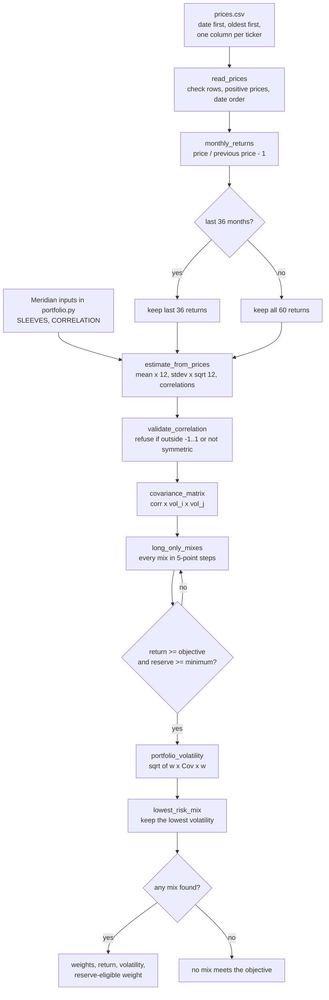

# Lab 15 — Least-Risk Mix and Its Stability

**Question:** Which mix carries the least risk while meeting the mandate, and does the answer survive a one-point change in one estimate?

**Answer:**

- **Meridian:** the least-risk mix that meets 6.5% with at least 3% reserve-eligible is **0% bills / 20% 10-year note / 25% IG bond fund / 55% global equity**. It returns 6.51% with **9.44%** volatility and holds 20% reserve-eligible.
  - **It does not survive.** One-point changes to single return estimates move weights by **20–40 points**.
  - The return objective binds, so the answer is driven by the return guesses.
- **My energy universe** (five-year history): the least-risk mix is **70% AMLP / 20% ICLN / 10% NLR**. It returns 15.14% with **16.11%** volatility.
  - **It survives every one-point return change unchanged.** The 8% objective is far below what the history shows, so it never binds. The answer is simply the lowest-volatility mix, which depends on volatilities and correlations, not returns.
  - Switching to the last 36 months moves it by 10 points.
  - **It breaks my own 40% single-fund cap.** That cap isn't in the app's search, so the app's answer is not mandate-compliant as is. With the cap applied (checked separately, see V), the answer is 15% XLE / 40% AMLP / 25% ICLN / 20% NLR at 17.14% volatility.

Built with AI help. A learning demonstration, not investment advice.

## R — Universe and mandate

| Input | Meridian (training) | Mine (Project 2: energy) |
|---|---|---|
| Assets | Lab 14's four sleeves | XLE, XOP, AMLP, ICLN, NLR (five energy ETFs) |
| Return, volatility, correlation | Lab 14's tables | Estimated from 60 monthly returns, Sep 2021 – Sep 2026 (`prices.csv`) |
| Objective | 6.5% expected return | **8.0% expected annual return** |
| Hard constraint | Reserve-eligible weight ≥ 3% | **No single fund above 40%** |

The objective and constraint were chosen with AI help when I asked for energy funds. They are my working mandate, not a real client's stated needs. 8% is a long-run equity-like growth target, set independently of the price history. The 40% cap carries Lab 13's concentration idea over to funds, so no single energy theme can dominate.

### The funds

| Ticker | Fund | Energy exposure |
|---|---|---|
| XLE | State Street Energy Select Sector SPDR ETF | Large integrated oil & gas (S&P 500 energy sector) |
| XOP | State Street SPDR S&P Oil & Gas Exploration & Production ETF | Oil & gas producers (equal-weighted, more volatile) |
| AMLP | Alerian MLP ETF | Midstream pipelines and storage (MLPs) |
| ICLN | iShares Global Clean Energy ETF | Solar, wind and other clean-energy companies |
| NLR | VanEck Uranium and Nuclear ETF | Uranium miners and nuclear utilities/suppliers |

### Prices: source and download

- **File:** `prices.csv` — Date first, oldest month first, one column per ticker, monthly **Adj Close** (adjusted for dividends and splits), 61 month-ends from 2021-09 to 2026-09.
- **Source:** Yahoo Finance chart data (`query1.finance.yahoo.com/v8/finance/chart/<TICKER>`, interval 1mo), the same data behind each ticker's Historical Data page, e.g. https://finance.yahoo.com/quote/XLE/history/
- **Downloaded:** October 22, 2026, through the Claude desktop browser, for all five tickers.
- **Integrity:** SHA-256 `c7c39b97894fe0cfa4074cfbbbd68de0edb84fb6d983a884fff3d7c6a784313e`. The checksum of the downloaded text matches the saved file.
- **Date convention:** Yahoo labels each monthly bar by its first day. The price is that month's last close, so `2021-09` = the September 2021 month-end.
- October 2026 is left out because the month is not finished.

### Estimates — five-year history, not a forecast

Annualized from 60 monthly returns: arithmetic mean × 12, volatility × √12.

| Fund | Return estimate (historical mean) | Volatility | Geometric CAGR (for reference) |
|---|---:|---:|---:|
| XLE | 24.13% | 26.02% | 23.00% |
| XOP | 19.26% | 30.09% | 15.89% |
| AMLP | 18.61% | 18.44% | 18.34% |
| ICLN | 0.59% | 28.88% | −3.45% |
| NLR | 19.94% | 29.06% | 17.03% |

| Correlation | XLE | XOP | AMLP | ICLN | NLR |
|---|---:|---:|---:|---:|---:|
| XLE | 1.00 | 0.93 | 0.82 | 0.17 | 0.24 |
| XOP | 0.93 | 1.00 | 0.79 | 0.21 | 0.25 |
| AMLP | 0.82 | 0.79 | 1.00 | 0.12 | 0.25 |
| ICLN | 0.17 | 0.21 | 0.12 | 1.00 | 0.44 |
| NLR | 0.24 | 0.25 | 0.25 | 0.44 | 1.00 |

**Label:** these returns are a five-year historical average, not a forecast. Sep 2021 – Sep 2026 included the 2022 energy price spike and a nuclear rally, so four of the five funds show returns near 20% a year. That is far above what anyone should expect going forward. Treat the return column as the most fragile input.


## I — The engine and the app

**Instruction given to the AI** (Lab 15 step 1, verbatim intent): in `portfolio.py`, keep everything it already prints exactly as it is. Add:

1. a search over every long-only mix in 5-point steps that keeps mixes meeting the objective and the reserve minimum and returns the lowest-volatility one, or nothing; and
2. an estimate from a CSV of monthly prices: mean × 12, standard deviation × √12, correlations, on all months or the last 36.

Then build `app.py`, a Streamlit app that imports these functions and the Meridian inputs from `portfolio.py`. It reuses them and never copies the math.

**Files** (in this folder):

| File | What it does |
|---|---|
| `portfolio.py` | Tuesday's engine plus `long_only_mixes`, `lowest_risk_mix`, `read_prices`, `monthly_returns`, `estimate_from_prices` (standard library only) |
| `app.py` | Streamlit page; all math calls `portfolio.py` |
| `prices.csv` | Five years of monthly Adj Close for XLE, XOP, AMLP, ICLN, NLR |

**Commands** (from this folder):

```sh
python portfolio.py          # Tuesday's printout, unchanged
pip install streamlit        # once, if Streamlit is not installed
streamlit run app.py         # opens the app in your browser
```

**App controls:**
- **Sidebar:** objective (starts at 6.5%), reserve minimum (starts at 3%), `prices.csv` upload, and a last-36-months switch.
- **Page:** an editable expected-return box per asset, a reserve-eligible tick box per asset (bills and the 10-year note ticked for Meridian), the lowest-risk mix for your inputs beside the answer for the inputs as loaded, and the largest weight change in points.

**For the energy CSV**, set the objective to 8% and the reserve minimum to 0%. No energy fund is reserve-eligible, so a 3% reserve minimum correctly shows "no mix meets the objective."

### How the engine flows



## V — Checks

| Check | Expected | Actual |
|---|---|---|
| `python portfolio.py` after the additions | Tuesday's values unchanged | **Byte-for-byte identical** to Tuesday's output (same SHA-256) |
| App opens on Meridian | Meridian's answer | 0 / 20 / 25 / 55, return 6.51%, volatility 9.44%, reserve 20%; no errors on the page or in the terminal |
| Edit equity return 8% → 7% in the app | answer moves | 0 / 10 / 10 / 80, volatility 12.94%; largest change **25 points** |
| Impossible objective (Meridian, 9%) | "no mix" | "No mix meets the objective" |
| Upload `prices.csv`, objective 8%, reserve 0% | energy answer | 0 / 0 / 70 / 20 / 10 (XLE / XOP / AMLP / ICLN / NLR), 15.14%, 16.11% |
| Last-36-months switch | answer may move | 0 / 0 / 75 / 25 / 0, 14.55%, 12.06%; largest change **10 points** vs all months |
| `streamlit run app.py` | server starts | started cleanly; health check "ok" |
| `prices.csv` integrity | matches download | SHA-256 matches the downloaded text |

**Bug found and fixed during testing:** with "last 36 months" on, the first version's "as loaded" answer mixed all-month returns with last-36 volatilities. It now uses the CSV's all-month estimates throughout.

### Known answer and engine proof (run through the app)

| Run | Bills / 10-year / IG / equity | Return | Volatility | Expected |
|---|---|---:|---:|---|
| As loaded | 0 / 20 / 25 / 55 | 6.51 | 9.44 | ✅ matches |
| Equity return box 8.0 → 7.0 | 0 / 10 / 10 / 80 | 6.53 | 12.94 | ✅ matches |
| Largest weight change | | | | **25 points** ✅ |
| IG–equity correlation set to 0.50 in `portfolio.py`, app reloaded | 0 / 40 / 0 / 60 | 6.52 | 9.73 | ✅ matches |
| Correlation set back to 0.25, app reloaded | 0 / 20 / 25 / 55 | 6.51 | 9.44 | ✅ restored |

- **One point off one estimate moves a quarter of the money.** Lowering equity's return by one point moves 25 points of weight.
- **The app is my engine.** Changing only `portfolio.py` changed the app's answer, so the app holds no second copy of the math. `portfolio.py` was restored byte-for-byte afterward.

### My universe in the app (prices.csv uploaded)

**Settings:** objective **8.0%**; reserve rule: no energy fund counts as reserve-eligible, so the reserve minimum is set to **0%**. The objective was not lowered to get an answer.

| Estimates | XLE / XOP / AMLP / ICLN / NLR | Return | Volatility |
|---|---|---:|---:|
| All 60 months (as loaded) | 0 / 0 / 70 / 20 / 10 | 15.14% | 16.11% |
| Last 36 months | 0 / 0 / 75 / 25 / 0 | 14.55% | 12.06% |

**Largest weight change: 10 points** (NLR, 10% → 0%; AMLP and ICLN each rise 5 points). Both runs found a mix, so the comparison is valid.

### One-point test — Meridian (6.5% objective, 3% reserve)

| Estimate changed | New least-risk mix (bills / 10-yr / IG / equity) | Volatility | Largest weight change |
|---|---|---:|---:|
| Base | 0 / 20 / 25 / 55 | 9.44% | — |
| Bills −1 pt | 0 / 20 / 25 / 55 | 9.44% | 0 |
| Bills +1 pt | 30 / 0 / 15 / 55 | 9.07% | 30 (bills) |
| 10-year −1 pt | 10 / 0 / 35 / 55 | 9.54% | 20 (10-year) |
| 10-year +1 pt | 0 / 55 / 0 / 45 | 7.82% | 35 (10-year) |
| IG bonds −1 pt | 0 / 40 / 0 / 60 | 9.73% | 25 (IG) |
| IG bonds +1 pt | 0 / 5 / 65 / 30 | 7.04% | 40 (IG) |
| Equity −1 pt | 0 / 10 / 10 / 80 | 12.94% | 25 (equity) |
| Equity +1 pt | 5 / 0 / 55 / 40 | 7.90% | 30 (IG) |

**Verdict:** seven of eight one-point changes move the answer 20–40 points. The return objective binds, so the "optimal" mix is a product of the return guesses. It should be presented as a range, not a single answer.

### One-point test — energy (8% objective, 0% reserve, all 60 months)

Every ±1-point change to any single return estimate leaves the answer at **0 / 0 / 70 / 20 / 10** (16.11% volatility), with largest change **0 points**.

**Verdict:** it survives, but for a revealing reason. The historical returns (≈15–24% for four funds) clear the 8% objective with room to spare, so the objective never binds. The answer is just the lowest-volatility mix, which depends only on volatilities and correlations. Those estimates are more fragile than the return test suggests: dropping to the last 36 months moved the answer 10 points.

### Mandate check the app does not do — 40% single-fund cap

My energy mandate caps any fund at 40%. The app's search (as specified) does not enforce that, and its answer holds **70% AMLP**, so it **breaks the mandate**. Rerunning the same 5-point search with the cap added gives:

| Estimates | Least-risk mix within the 40% cap (XLE / XOP / AMLP / ICLN / NLR) | Return | Volatility |
|---|---|---:|---:|
| All 60 months | 15 / 0 / 40 / 25 / 20 | 15.20% | 17.14% |
| Last 36 months | 30 / 0 / 40 / 30 / 0 | 14.12% | 13.17% |

The cap costs about 1 point of volatility and spreads the portfolio across four funds. Adding the cap as a sidebar control is the next change to the app.

## Limitations

- The search uses 5-point steps, so the true optimum may sit between grid points. The answers are within that resolution.
- The energy returns are a five-year historical average from a strong energy period (2022 oil spike, nuclear rally), not a forecast. ICLN's 0.59% and the other funds' ≈20% are both unlikely to repeat.
- Volatility is the only risk measure. It ignores fat tails, drawdowns, and the fact that the oil funds (XLE, XOP, AMLP) are 0.79–0.93 correlated and would fall together in an oil shock.
- The objective (8%) and the 40% cap are working assumptions for a hypothetical Project 2 client, chosen with AI help.

## AI disclosure

- **Access path:** Claude (configured model `claude-opus-5-5`; the serving model may differ), in the Claude desktop app with access to my `Fin 439` folder and its built-in browser.
- **Used for:**
  - choosing the five energy ETFs, the 8% objective and the 40% cap at my request
  - downloading monthly prices from Yahoo Finance through the browser
  - writing the new `portfolio.py` functions and `app.py`
  - testing the app with Streamlit's AppTest and a live `streamlit run`
  - running the one-point tests
  - drawing the Mermaid flowchart
  - drafting this file
- **Verified:**
  - `portfolio.py` output unchanged (checksum)
  - `prices.csv` matches the download (checksum)
  - app results match direct function calls
  - a bug in the app's "as loaded" comparison was found and fixed
- **My own checks / disposition:** [fill in what you verified yourself and what you accepted, changed or rejected]
